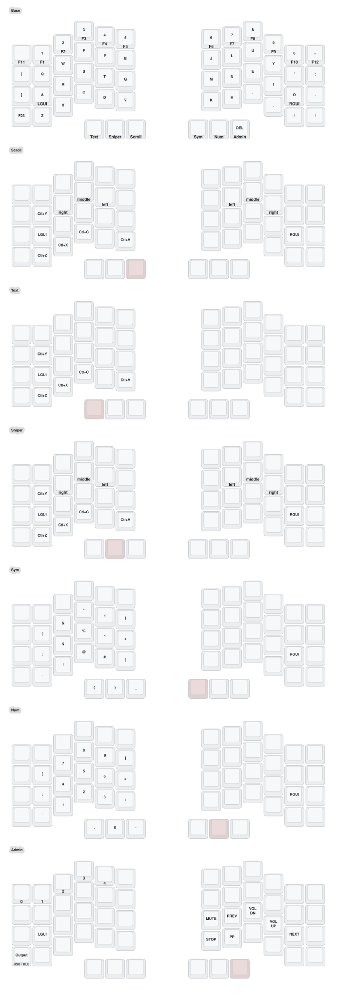

# ZMK configuration

Personal ZMK configuration repository, currently containing custom firmware
for a 54-key Bridges V2 with dual PAW3222 trackballs. The layout is
Colemak-DH and combines Miryoku-style layers with Urob-style "timeless"
home-row mods.

## Base layout

- Number row: tap `` ` ``, `1`-`0`, `=`; the number keys hold `F1`-`F10`,
  grave holds `F11`, and equals holds `F12`.
- Home-row mod-taps:
  - left: `A/GUI`, `R/Alt`, `S/Ctrl`, `T/Shift`
  - right: `N/Shift`, `E/Ctrl`, `I/Alt`, `O/GUI`
- The mod-taps use positional, balanced "timeless" settings. Pointer layers
  use immediate modifiers in the same positions.
- Thumbs: `Esc/Text`, `Space/Sniper`, `Tab/Scroll`, `Enter/Sym`,
  `Backspace/Num`, `Delete/Admin`.
- The left outer-bottom key emits `F23` for host-side application bindings;
  the right outer-bottom key is backslash/pipe.

## Current pointing setup

The right trackball provides the layer-controlled modes below. The left
trackball is a dedicated always-on adaptive scroll device with a keypress guard
that briefly suppresses movement after physical key presses to reject typing
vibration without imposing a scroll dead zone.

| State | Behavior |
| --- | --- |
| Default | Cursor with speed-based acceleration; ordinary typing keys are never remapped automatically |
| Hold Tab | Coalesced adaptive vertical/horizontal scrolling |
| Hold Esc | Trackball arrows; physical `N/E/I/O` are left/down/up/right |
| Hold Space | Quarter-speed cursor with the mirrored click keys |

The left trackball remains adaptive scroll in every state, including while a
right-trackball mode is held. Holding Tab therefore makes both balls scroll.
Its gain is set independently because equal repeated gestures produced
substantially less raw distance with the left hand; recalibrate it from the
tuner's Calibration panel.

Both balls run on `zmk-pointing-tools` pipelines on the central: one router
per ball, with the right ball's pipeline chosen by the active layer. The left
half sends each coalesced 16 ms frame to the central as one compact split
event, so the central sees exact signed counts with sequence and timing.
Distances are physical (micrometres and steps per metre), so changing CPI
changes cursor speed without changing scroll speed, text steps, or the
motion gate.

Text, Scroll, and Sniper also provide `Q/Z/X/C/V` as
Redo/Undo/Cut/Copy/Paste. Held Shift combines with those shortcuts for terminal
copy/paste. Text uses only the left home-row modifiers and disables unrelated
keys.

Hold Enter or Backspace for stripped canonical Miryoku Sym and Num layers.
Hold Delete for Bluetooth profiles, media controls, and the USB/BLE output
toggle.

### Admin controls

- Left number row: Bluetooth profiles 0-4 and clear.
- Right home: mute, previous, volume down/up, and next.
- Right bottom: stop and play/pause.
- Left outer-bottom key: output toggle.

The dual-role thumbs support tap-then-hold repeat: for example, tap Backspace
and quickly hold it to repeat Backspace instead of opening Num.

## Compiled tuning values

Edit `config/bridges_v2.keymap`:

- home-row mod timing: `tapping-term-ms`, `quick-tap-ms`, and
  `require-prior-idle-ms` in `lhm`/`rhm`
- cursor gain: `scale-multiplier` / `scale-divisor` on
  `zpt_right_cursor_transfer`, and the acceleration curve on
  `zpt_right_cursor_acceleration` (slow and fast speeds in mm/s, gains in
  percent)
- cursor noise gate: `zpt_right_cursor_gate`, compiled as a pass-through until
  `enabled` is added
- cursor report coalescing: `report-interval-ms` on
  `zpt_right_cursor_coalescer`
- sniper speed: `scale-divisor` on `zpt_right_sniper_transfer`
- scroll speed: `steps-per-meter` on `zpt_right_scroll_batcher` and
  `zpt_left_scroll_batcher`
- scroll axis intent: `engage-ratio-percent`, `release-ratio-percent`,
  `activation-distance-micrometers`, and `window-ms` on the `*_scroll_intent`
  stages
- Text steps: `horizontal-threshold-micrometers` and
  `vertical-threshold-micrometers` on `zpt_right_text_nav` (lower is faster)
- Text gesture classification: `zpt_right_text_intent`
- left keypress guard: `suppress-after-keypress-ms` on `zpt_keypress_guard`
- CPI: `resolution-cpi` on `zpt_right_ball` and `zpt_left_ball` (multiples of
  38 from 608 to 4826; the boards' `res-cpi = <700>` runs at 684)

Unless the keymap comments say otherwise, these reproduce the previous
processor configuration at 684 CPI. The cursor acceleration curve is new and
is a starting point to tune on the keyboard.

## Pointing telemetry, runtime tuning, and calibration

Connect the right half over USB, then run the local tuner from a sibling
checkout:

```console
cd ../zmk-pointing-tools
devenv up
```

Open <http://localhost:8787> in desktop Chrome. Every tunable stage appears
as its own target under its stable id (for example `right-cursor-transfer` or
`left-scroll-batcher`), along with both balls' CPI. Changes are previews held
in RAM; reset them from the page or reboot to restore the Git-tracked
defaults. **Copy config** generates a reviewable devicetree overlay for
transferring current values back into this repository, and profiles can be
exported and imported by stable id.

The Calibration panel sets gain from repeated gestures: measure from a ball's
`*-normalize` stage, choose the target (cursor transfer, scroll batcher, or
text navigation), enter what one gesture should produce, and repeat it 5 to
10 times. It recommends a value with its confidence, applies it as a preview,
and exports it as an importable profile. Per-stage diagnostics are off until
requested and stop automatically if the tuner's heartbeat disappears.

## Building

The development environment is managed by Devenv 2.2. With Devenv installed,
trust the repository once to enable native shell activation:

```console
devenv allow
```

Fish normally loads Devenv's activation hook automatically. You can also enter
the environment explicitly with `devenv shell`.

The official ZMK CLI is available as `zmk` for repository management:

```console
zmk keyboard list
zmk module list
zmk code bridges_v2
zmk download
```

Local firmware compilation is performed by West and orchestrated with Devenv
tasks:

```console
# Initialize or update the pinned West workspace.
devenv tasks run firmware:workspace:sync

# Build one target.
devenv tasks run firmware:build:bridges:left
devenv tasks run firmware:build:bridges:right

# Build every Bridges target, including the manual settings-reset images.
devenv tasks run firmware:build:bridges

# Regenerate or verify the keymap drawing.
devenv tasks run keymap:draw
devenv tasks run keymap:check

# Run generated-file, repository, and toolchain validation without compiling.
devenv tasks run firmware:validate

# Run the complete parallel build and validation graph.
devenv test --no-tui
```

Firmware is collected in `firmware/`, with separate build directories under
`.build/`. The out-of-tree West checkout is stored in `.west-workspace/` so it
does not conflict with this repository's own `zephyr/module.yml`.

`config/west.yml` pins ZMK, Zephyr, the independent Bridges board fork,
`zmk-pointing-tools`, and the transitional trackball modules to exact commits.
Its Zephyr import is restricted to the modules used by the nRF52840 Bridges
hardware. `devenv.lock` separately pins the local Nix toolchain and development
utilities.

Pull requests and pushes to `main` build the two production images in
`build.yaml` through the pinned Nix-based `urob/zmk-actions` workflow. The reset
images in `build-reset.yaml` and the official ZMK fallback are separate manual
workflows. Devenv remains the local source of truth; its full build is tested in
CI only when the environment or local build scripts change.

The current generated keymap is shown below.


